# Compromise Ledger: a visual tour

What this project does, how it works, and where it is going, in pictures and plain language. No
engineering background is needed. Each section starts with the big picture and then adds detail,
and the [Technology map](#technology-map) names the open-source tools behind each part and why
they were chosen.

*State as of 2026-11-15. Numbers come from the live site, <https://cl.kuricove.com/>, which
refreshes every day.*

**Contents:**
[The idea](#the-idea) ·
[What it does](#what-it-does) ·
[Where the data comes from](#where-the-data-comes-from) ·
[One flaw, followed end to end](#one-flaw-followed-end-to-end) ·
[What the data shows so far](#what-the-data-shows-so-far) ·
[How a day's update works](#how-a-days-update-works) ·
[Raw, cleaned, published](#raw-cleaned-published) ·
[Trust and safety](#trust-and-safety) ·
[Technology map](#technology-map) ·
[Where it runs](#where-it-runs) ·
[Roadmap](#roadmap) ·
[Glossary](#glossary)

---

## The idea

Companies that sell security products (firewalls, VPNs, antivirus) ask to be trusted with the
front door. Compromise Ledger asks a simple question: **how often are those products themselves
the way attackers get in?** It also tracks which organizations report being attacked, how long
breaches go unnoticed, and how long it takes to tell the public.

The project has three goals:

| Goal | What it means here |
|---|---|
| **Insight** | Clear, sourced answers about security incidents and flaws in security products. |
| **Openness** | Every number can be downloaded, checked, and reused, under an open license. |
| **Engineering quality** | Built the way a modern data platform should be: traceable, tested, and run on open-source tools. |

## What it does

The whole system in one picture: public records go in, are checked and combined, and come out as
a website, downloadable files, and an API that other programs can query.

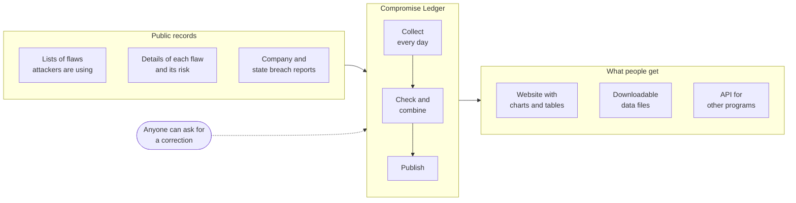

Two promises shape everything else: **every fact links back to where it came from**, and
**nothing stolen is ever collected**. Only public records and metadata about them.

## Where the data comes from

Seven public sources, all collected automatically every day. They fall into two groups: facts
about **flaws in products**, and reports about **organizations that were attacked**.

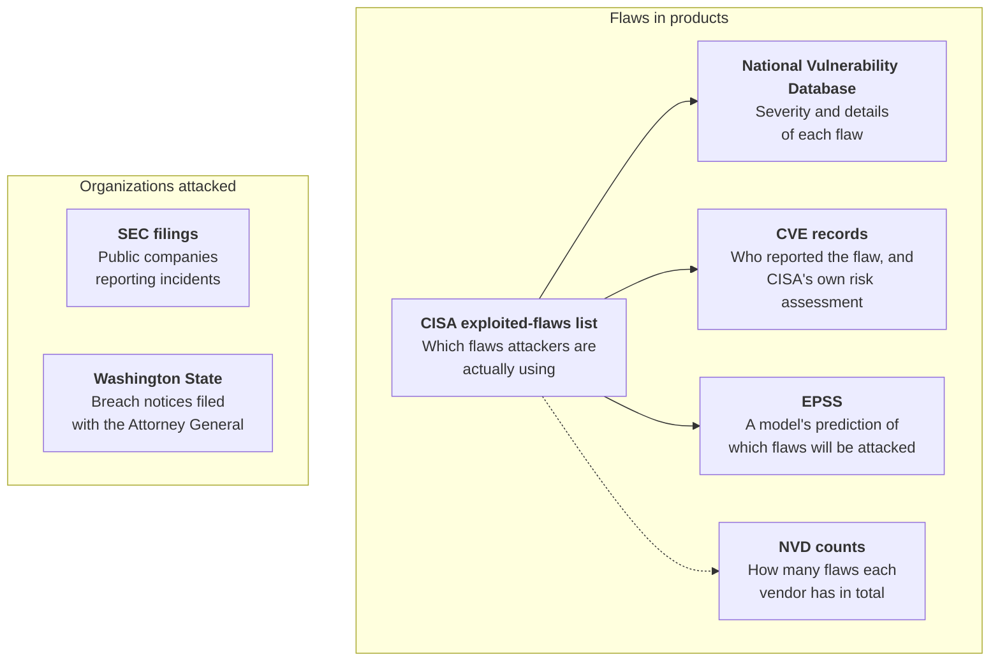

| Source | Publisher | What it adds | Updated |
|---|---|---|---|
| Known Exploited Vulnerabilities | CISA (US cybersecurity agency) | The core list: about 1,800 flaws confirmed as used in real attacks | Weekdays |
| National Vulnerability Database | NIST | Severity scores, flaw types, publication dates | Continuously |
| NVD vendor counts | NIST | Each vendor's total number of known flaws, to compare fairly | Daily |
| CVE records | The CVE Program, with CISA | Who assigned each flaw its ID, and CISA's assessment of how dangerous it is | Continuously |
| Exploit Prediction Scoring System (EPSS) | FIRST | The predicted chance of attack, the day before CISA confirmed one | Daily |
| Form 8-K filings | US Securities and Exchange Commission | Cybersecurity incidents that listed companies disclose | Daily |
| Data breach notices | Washington State Attorney General | Breaches affecting more than 500 residents: when they began, were found, and were reported | Daily |

Every source is a public record or openly licensed, and each license is recorded with the data.

## One flaw, followed end to end

To make this concrete, here is one real entry: **CVE-2024-21762**, a flaw in **FortiOS**, the
software in Fortinet's firewalls.

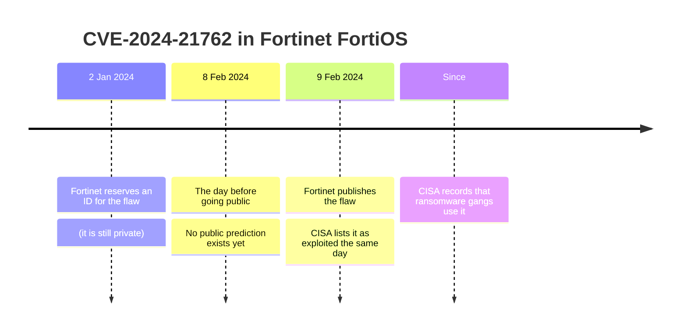

What the ledger knows about it, and where each fact comes from:

| Fact | Value | Source |
|---|---|---|
| Vendor and product | Fortinet, FortiOS | CISA list |
| Is the vendor a security company? | Yes | The project's curated vendor list |
| Days from going public to being listed as exploited | **0** | CISA list and CVE record |
| Used by ransomware gangs | Yes | CISA list |
| Severity | 9.8 out of 10, critical | NVD; Fortinet's own rating has the same base score |
| Can the attack be automated? | Yes | CISA's assessment in the CVE record |
| What an attacker gains | Total control of the device | CISA's assessment |
| Predicted risk the day before | None: it was not public yet | EPSS |

This pattern, a security product attacked before or on the day its flaw becomes public, is what
the project measures across every vendor.

## What the data shows so far

Headline findings, as of 2026-11-15. CISA's list holds 1,781 exploited flaws; 156 of them are in
security vendors' own products.

| Question | Security vendors' products | Everyone else's |
|---|---|---|
| Flaws known to be used by ransomware | **35%** | 19% |
| Typical days from going public to being listed as exploited | **3** | 8 |
| Listed as exploited within a week of going public | **61%** | 49% |
| Can be attacked automatically, with total control | **52%** | 31% |
| Had no public risk prediction the day before listing | **31%** | 17% |

In short: when security products are attacked, the flaws tend to be **severe, fast, and easy to
automate**, and often **already exploited before the world knows they exist**.

The breach notices tell a second story. Organizations notice breaches far sooner than they used
to, but take longer to report them:

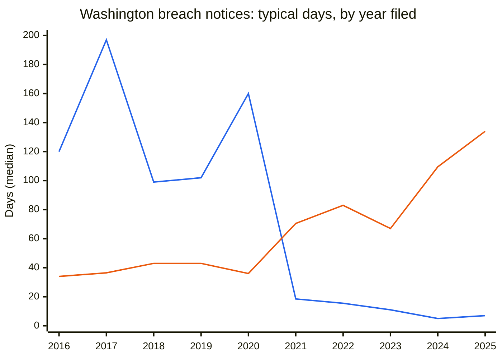

*Blue, falling: days from a breach starting to the organization noticing it. Orange, rising: days
from noticing to notifying the Attorney General. State law asks for 30 days, with exceptions.*

| Year | Notices | Days to notice | Days to report |
|---|---|---|---|
| 2016 | 49 | 120 | 34 |
| 2020 | 204 | 160 | 36 |
| 2023 | 252 | 11 | 67 |
| 2025 | 209 | 7 | 134 |

The caveats matter, and the site states them next to every chart: CISA's list reflects what CISA
sees, groups of security vendors are small, and a late notice is not necessarily a violation.
The [method page](https://cl.kuricove.com/method) explains each measure.

## How a day's update works

Every morning at 04:30 UTC the system refreshes itself, start to finish, without anyone touching
it. If anything breaks, it says so.

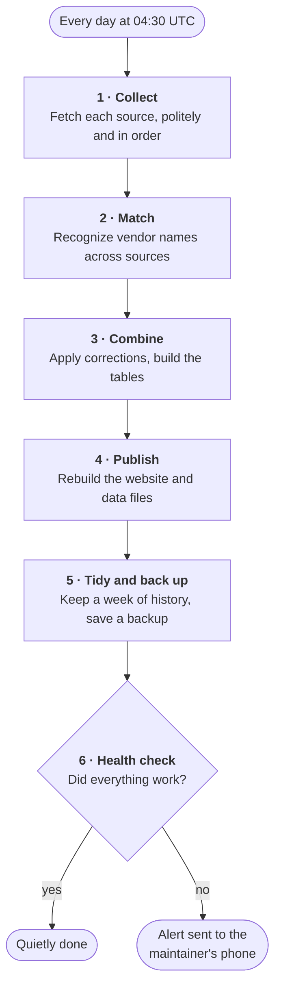

Some sources depend on others: risk predictions are looked up only for flaws already on CISA's
list, so CISA's list is collected first. Each source declares what it needs, and the scheduler
works out the order.

If one source fails, the rest still run, and the website keeps yesterday's data for that source.
If the daily run doesn't happen at all, an outside service notices the silence and raises the
alarm.

## Raw, cleaned, published

Data moves through three stages, so that every published number can be traced back to the exact
document it came from, and everything can be rebuilt from the original records.

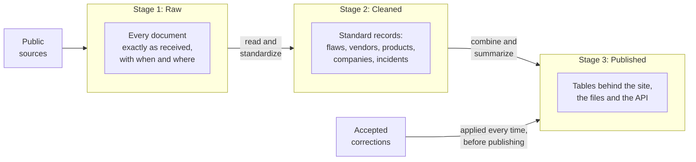

Engineers call these stages **bronze, silver, and gold**. Each published row carries its source
link, when it was collected, a confidence score from 0 to 100, and the source's license.

## Trust and safety

This dataset names real organizations, so it is built to be careful by design, not just by
policy.

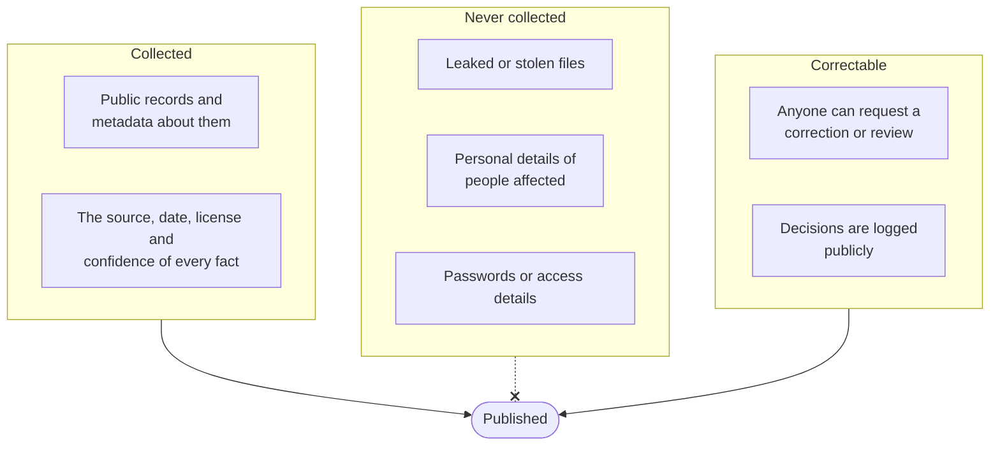

- **Claims are labeled as claims.** An incident is *confirmed* only when the organization or a
  regulator says so.
- **Breach notices are published as statistics only.** A notice says an organization's data was
  exposed, not necessarily that it was attacked (its supplier may have been), so the site
  doesn't list notifiers by name.
- **Collectors can't download files.** Each one may contact only the addresses it declares,
  accepts only the formats it expects, and identifies itself to the sites it visits.

Details: [data policy](DATA_POLICY.md) and [corrections process](../CORRECTIONS.md).

## Technology map

### What the parts do

The same system as in [What it does](#what-it-does), now split into its working parts.

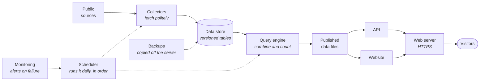

### The tools behind them

Every tool is open source under a license approved by the Open Source Initiative. That is a
hard rule: tools whose licenses restrict use, such as Terraform and Vault, are avoided in favor of
open alternatives (OpenTofu and OpenBao).

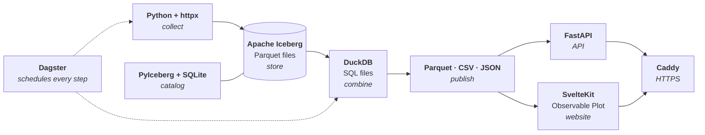

| Part | Tool | What it does, in plain terms | Why this one |
|---|---|---|---|
| Collect | **Python** plugins using **httpx** | Visits each source, downloads its records, and follows the source's rules on speed and access | One small plugin per source, so adding a source never touches the others; every plugin is tested offline against saved copies of real responses |
| Schedule | **Dagster** | Runs the daily steps in the right order, shows each run, and re-runs one source on demand | Treats each dataset as an item with dependencies and health checks, and draws them as a graph; free and open source |
| Store | **Apache Iceberg** with **Parquet** files | Keeps every table with its history and lets new columns be added safely | An open table format any analytics engine can read, so the data isn't tied to one product |
| Catalog | **PyIceberg** with **SQLite** | Remembers which files make up each table | The lightest option that works, a single file; a catalog server comes only when needed |
| Combine | **DuckDB** and SQL files | Joins and counts the data to build the published tables | Fast analytics in a single library, no database server; each published table is one readable SQL file |
| Data model | **STIX 2.1**-style records | Describes flaws, vendors, and incidents in a standard shape | The common language of threat-intelligence tools, so the data can feed them |
| Serve data | **FastAPI** | The read-only API, with interactive documentation | Generates its own documentation from the code |
| Website | **SvelteKit** and **Observable Plot** | Builds the site as plain pages from the published files, with charts | Pages are prebuilt, so the site is fast and has almost nothing to attack |
| Web server | **Caddy** | Serves the site and API over HTTPS | Gets and renews security certificates on its own |
| Run | **Docker Compose** on **Debian** | Packages every part and runs them on one server | The same setup runs on a laptop and the server; nothing installed by hand |
| Watch | **ntfy**, **healthchecks.io**, GitHub issues | Sends a phone alert when a source breaks, and notices if the daily run never happens | Simple, free, and independent of the server, so a dead server still raises an alarm |
| Protect | **gitleaks**, **Trivy**, **Renovate**, **OpenSSF Scorecard** | Blocks leaked secrets, scans for known flaws, keeps dependencies current, and grades the project's practices | A project about security flaws should practice what it measures |

**Lean first:** heavier tools (a message broker, a search engine, Kubernetes) are on the roadmap,
but each is added only when a real need appears, and the reason is written down. Data volumes
are small, about 300,000 flaws in total, so a laptop-sized engine is enough for now.

## Where it runs

Everything runs on one small rented server, each part in its own Docker container. It uses about 1.5 GB of its 8 GB of memory during a
daily run.

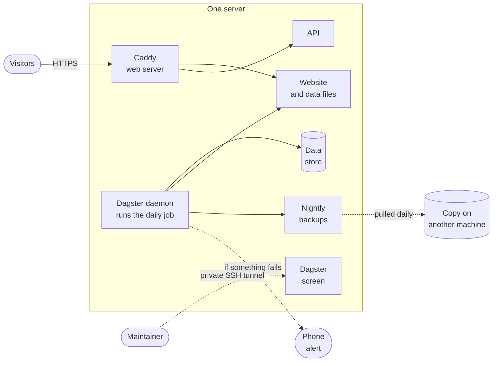

- **Only the website and API are public.** The scheduler's screen has no login, so it is
  reachable only through an encrypted connection from the maintainer's machine.
- **Backups leave the server.** Another machine pulls the newest nightly backup each day, and a
  restore has been rehearsed.
- **Everything can be rebuilt.** The original documents are kept, so every table, file, and page
  can be regenerated from them.

Setup steps: [SELF_HOSTING.md](SELF_HOSTING.md).

## Roadmap

The project is built in four phases. Each ends with something public, and the next phase starts
only when a written checklist (a "gate") is met.

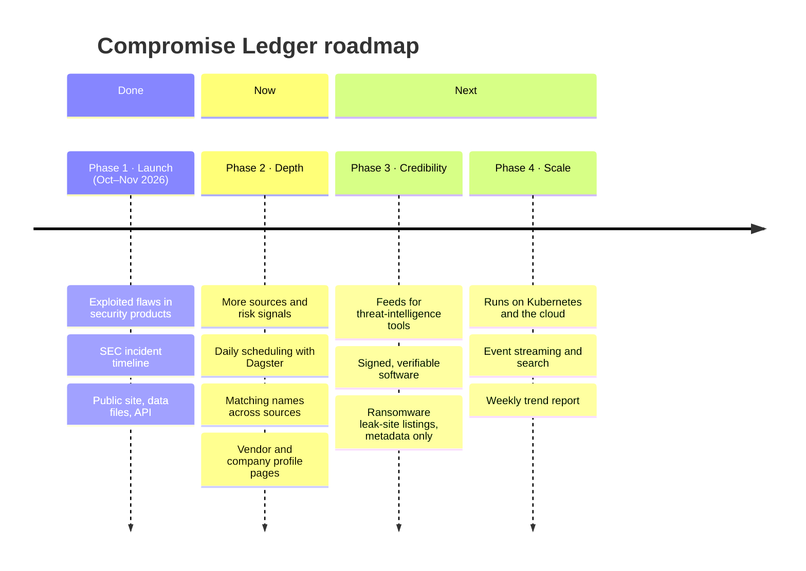

### Phase 2 in detail

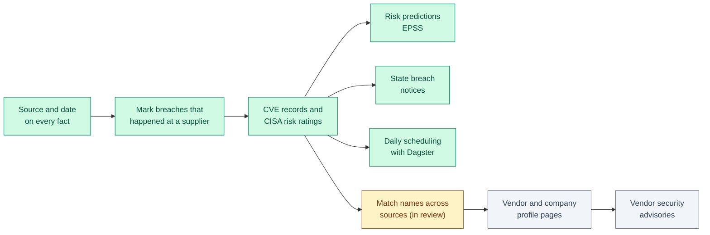

*Green: done. Amber: next. Grey: later.*

| Phase | Goal | Status | The gate to finish it |
|---|---|---|---|
| 1. Launch | Real data, a public dashboard, downloadable files | **Done** (closed 2026-11-12) | Site live; daily updates ran for two weeks without help; files match their checksums |
| 2. Depth | Better data quality and richer exploration | **In progress**: 2 of 3 gate checks met | Name matching measurably reduces duplicates; every fact carries its source (met); failures detected within a day (met) |
| 3. Credibility | Work with professional security tools; harden the software supply chain | Planned | Feed read by OpenCTI or MISP; signed software verifiable from the README; leak-site collectors proven to fetch listings only |
| 4. Scale | Run anywhere, including the cloud | Planned | A full cloud environment created and torn down with one command |

The full plan, with each step's reasoning: [ROADMAP.md](ROADMAP.md). Decisions are recorded in
[architecture decision records](adr/).

## Glossary

| Term | Meaning |
|---|---|
| **Vulnerability, flaw, CVE** | A security weakness in software. A *CVE* is its public ID, such as CVE-2024-21762. |
| **KEV** | CISA's *Known Exploited Vulnerabilities* list: flaws with evidence of real attacks. |
| **Exploited** | Actually used by attackers, not just possible. |
| **Security vendor** | A company whose main business is security, such as Fortinet, Palo Alto Networks, or Sophos. Generalists like Cisco or Microsoft don't count, even with security products. |
| **CNA** | The organization that assigned a flaw its CVE ID, often the vendor itself. |
| **CVSS** | A 0–10 severity score for a flaw. |
| **SSVC** | CISA's way of rating a flaw by decisions: is it exploited, can it be automated, how much control does it give? |
| **EPSS** | A model that predicts how likely a flaw is to be attacked in the next 30 days. |
| **8-K** | The form US public companies use to report important events to the SEC, including cyber incidents. |
| **Provenance** | Where a fact came from, when, and how much it can be trusted. |
| **Bronze, silver, gold** | The three stages of data: raw, cleaned, published. |
| **API** | A way for other programs to request the data directly. |
| **Open source** | Software whose code anyone may read, use, and change. |

---

### Keeping this page current

The diagrams are written in [Mermaid](https://mermaid.js.org/), plain text that GitHub draws
automatically, so they are edited like any other text and reviewed in the same change as the
code. When a change affects what this page shows (a new source, a new component, a roadmap
step), update the matching diagram and table in the same change, and refresh the numbers and
the date at the top. To preview, use GitHub's preview or the [Mermaid live editor](https://mermaid.live/).
